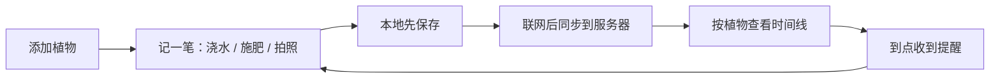

# 芽历 项目总览

> 芽历是一个在手机浏览器里用的阳台种植记录应用：给每盆植物记浇水、施肥和照片，到点提醒，断网时也能记。

## 一分钟看懂

| 问题 | 结论 |
| --- | --- |
| 它解决什么问题？ | 植物一多就记不清哪盆什么时候浇过水，照片散在相册里对不上日期 |
| 核心体验是什么？ | 打开即记一笔，按植物看时间线，到点收到提醒 |
| 怎样做出来的？ | 先做能离线记录的前端，再接后端同步，最后加提醒和照片 |
| 最值得复用的经验是什么？ | 状态只放在内存里迟早会丢；时间一律存 UTC，显示时再换算 |
| 当前状态确定吗？ | 材料只覆盖 2025 年 1 月到 4 月的开发过程，服务器是否仍在运行需要重新确认 |

## 使用闭环

## 阶段

| 阶段 | 主要工作 | 得到的结果 |
| --- | --- | --- |
| 离线原型 | 前端页面、本地存储 | 不联网也能完整记录和查看 |
| 接入后端 | 接口、数据库、同步队列 | 换手机后记录还在 |
| 提醒与照片 | 定时任务、照片上传与压缩 | 到点提醒；照片进入时间线 |
| 上线 | 进程托管、反向代理、备份 | 自己和家人日常在用 |

## 技术组成

| 层 | 主要组成 |
| --- | --- |
| 前端 | Vue 3、Pinia、Service Worker（PWA） |
| 后端 | Flask、SQLite、APScheduler |
| 部署 | systemd、Caddy、一台小型云服务器 |

## 按问题阅读

| 你想了解…… | 去这里 |
| --- | --- |
| 记录怎样存储和同步 | [[01_数据与同步]] |
| 某个故障的症状和根因 | [[02_问题与排查]] |
| 为什么选择某个方案 | [[03_决策记录]] |
| 可复用的命令和 AI 指令 | [[04_指令与命令]] |
| 快速查术语 | [[05_术语表]] |

## 仍需重新确认

- 服务器和域名当前是否可用。
- 每日备份是否仍在执行，恢复是否演练过。

---

资料边界：本页根据 2025 年 1 月到 4 月的开发对话整理。对话里的截图没有解析，不在结论范围内。
