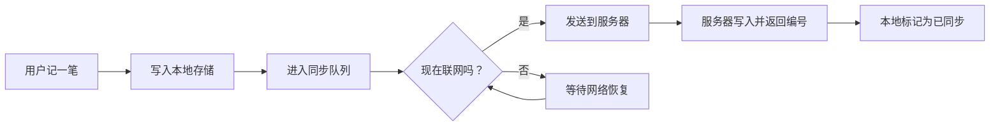

# 芽历 数据与同步

> 记录先写在手机本地，联网后再送到服务器。这页讲数据长什么样、同步怎么走、冲突怎么处理。

## 一条记录的流向

## 主要数据

| 对象 | 关键字段 | 说明 |
| --- | --- | --- |
| 植物 | 名称、位置、添加日期 | 一盆植物一条 |
| 记录 | 植物、类型、发生时间、备注 | 类型为浇水、施肥、拍照 |
| 提醒 | 植物、间隔天数、下次时间 | 下次时间由最近一次浇水推算 |
| 照片 | 记录、文件路径、拍摄方向 | 原图压缩后保存 |

## 同步规则

- **本地先成功。** 点了保存就算记上了，不等服务器回应。
- **每条记录带一个本地生成的唯一编号。** 重发时服务器靠它识别重复，不会记两笔。
- **发生时间存 UTC。** 显示时按手机时区换算。原因见 [[02_问题与排查#浇水日期比实际早一天]]。
- **同一条记录两边都改过时，以修改时间晚的为准。** 这是当时的选择，理由见 [[03_决策记录#D2：冲突时后改的覆盖先改的]]。

## 不能从材料得出的结论

- 多人同时编辑同一盆植物时是否会丢数据。对话里只测过单人换设备。
- 同步队列很长时的表现。没有压力测试的记录。

---

资料边界：字段和规则来自 2025 年 2 月的设计讨论和随后的实现对话。
