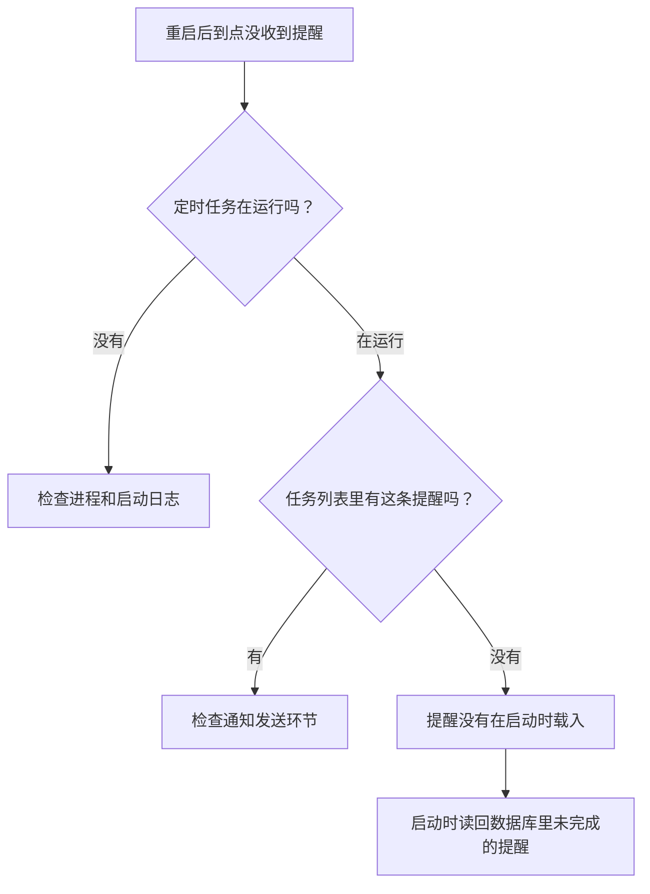

# 芽历 问题与排查

> 先在索引里按症状定位，再看详细链路。结论来自当时的对话，同类问题再出现时仍要重新取证。

## 故障索引

| 症状 | 定位到的关键边界 | 处理方向 | 最小验证 |
| --- | --- | --- | --- |
| 服务重启后提醒不再触发 | 提醒只存在内存里 | 启动时从数据库读回未完成的提醒 | 重启后到点仍收到提醒 |
| 浇水日期比实际早一天 | 服务器按 UTC 取日期，手机在东八区 | 时间存 UTC，日期在前端按本地时区算 | 凌晨记一笔，日期显示为当天 |
| 竖拍的照片显示成横的 | 压缩时丢了方向信息 | 压缩前先按方向信息旋转 | 竖拍、横拍各传一张都正常 |

## 服务重启后提醒不再触发

起初怀疑定时任务没有随服务启动。日志显示任务在跑，但任务列表是空的：提醒创建时只加进了内存，数据库里有记录，启动时却没有读回来。

查日志用的命令在 [[04_指令与命令#查看服务日志]]。

**经验：**“任务在运行”和“任务知道该做什么”是两回事。凡是重启后要继续的状态，都要能从数据库重建。

## 浇水日期比实际早一天

| 排查项 | 看到的情况 |
| --- | --- |
| 手机上的记录时间 | 4 月 3 日 0:20 |
| 数据库里存的时间 | 4 月 2 日 16:20（UTC） |
| 列表里显示的日期 | 4 月 2 日 |
| 日期是在哪里算的 | 服务器把 UTC 时间直接截成日期返回 |

存储没有错，错在服务器替前端算了日期。改为服务器只返回完整时间，日期由前端按手机时区换算。

**经验：**时间存 UTC 没问题，但“哪一天”是和时区有关的概念，要在知道用户时区的地方算。

## 竖拍的照片显示成横的

手机竖拍的照片，像素其实是横着存的，另用一个方向标记告诉看图软件该怎么转。压缩时重新生成了图片，方向标记没带过去，于是显示成横的。

处理是压缩前先按方向标记把像素转正。对话里记录了竖拍和横拍各一张的验证，前置摄像头的镜像情况没有测。

**经验：**处理图片的每一步都要问：元信息还在不在。

---

资料边界：三个故障都发生在 2025 年 3 月到 4 月。修复后的长期表现没有记录。
